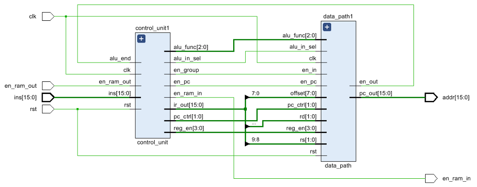
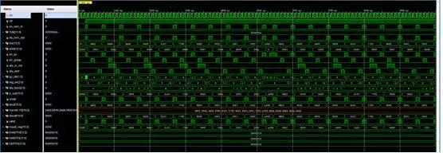

# RISC16 — a 16-bit RISC CPU in Verilog

A 16-bit, load-store RISC CPU designed, implemented and verified in **Verilog**
using **Vivado**, as the five-lab design strand of UESTC2001 *Application and
Design of Digital Logic* (Glasgow College, UESTC). The course supplies a module
framework; the architecture specification, ALU implementation, multi-cycle
control FSM, ROM test program and all verification testbenches are my work,
documented in the [formal design report](docs/RISC16_CPU_Design_Report.pdf).

## Architecture

* **ISA** — load-store, 16-bit data and address buses.
  Instruction format:

  | Bits | Field |
  |---|---|
  | `[15:12]` | opcode |
  | `[11:10]` | `rd` (destination register) |
  | `[9:8]`   | `rs` (source register) |
  | `[7:0]`   | zero-extended immediate / offset |

* **Datapath** (`data_path.v`) — register file (`reg_group.v`), seven-operation
  ALU (`alu.v`: pass-B/move, add, subtract, AND, OR, left shift, right shift,
  selected by `alu_func[2:0]`), operand multiplexer (`alu_mux.v`) and program
  counter (`pc.v`).

* **Control unit** (`control_unit.v` + `state_transition.v`) — a multi-cycle
  FSM stepping fetch → decode → execute → write-back, generating the enable,
  `pc_ctrl` and ALU-select lines. An `alu_end` handshake from the datapath
  holds the FSM in Execute until the operation completes.

* **Top level** (`cpu.v`) wires datapath and controller together; a
  parameterised `rom.v` holds the test program.



## Verification

Module-level benches (`tb_alu.v`, `tb_state_transition.v`) plus a full-system
bench (`tb_top_cpu.v`, Tclk = 10 ns) driving an **11-instruction ROM program
that exercises every opcode** — MOVE, ADD, SUB, OR and a terminating
self-looping JUMP — checked against an expected-result table and debugged from
waveforms and synthesised RTL schematics.



## Repository layout

```
src/     Verilog sources (Lab 2 datapath stage: implemented ALU + framework modules)
report/  LaTeX source and figures of the formal design report
docs/    Compiled design report (PDF)
```

**Status:** the final integrated sources (completed control FSM, ROM program,
full-system testbenches and the extended instruction set from Lab 5) live in
the Vivado project and are being added — see TODO. The design report in
`docs/` documents the complete, verified design.

## TODO

- [ ] Add final sources from the Vivado project
      (`<project>/<project>.srcs/sources_1/new/*.v` and
      `<project>/<project>.srcs/sim_1/new/*.v`):
      `control_unit.v`, `state_transition.v`, `cpu.v`, `rom.v` (with program),
      `top_cpu.v`, `tb_state_transition.v`, `tb_cpu.v`, `tb_top_cpu.v`.
- [ ] Add the Lab 5 extended-instruction-set variant.
